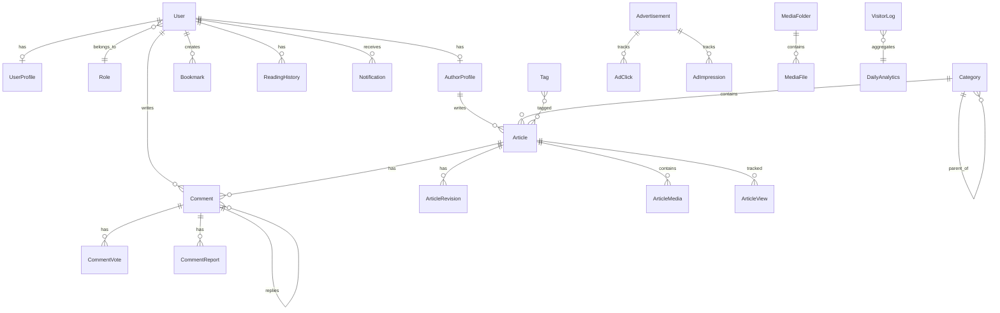
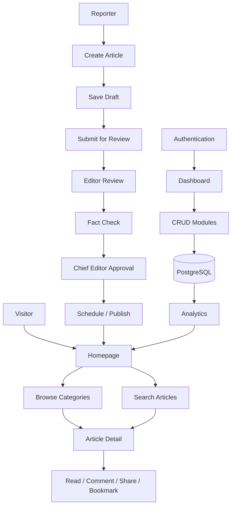
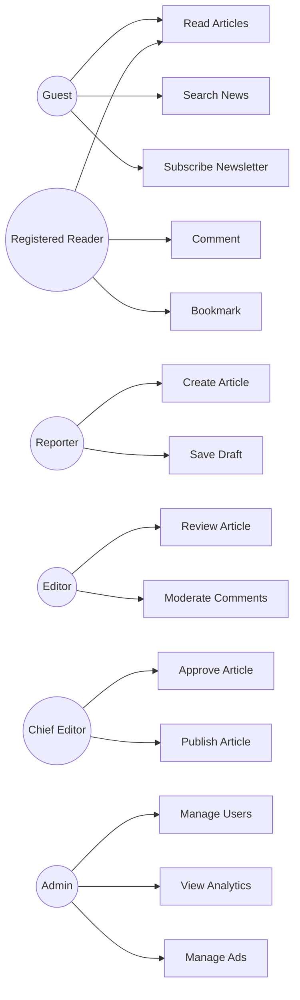
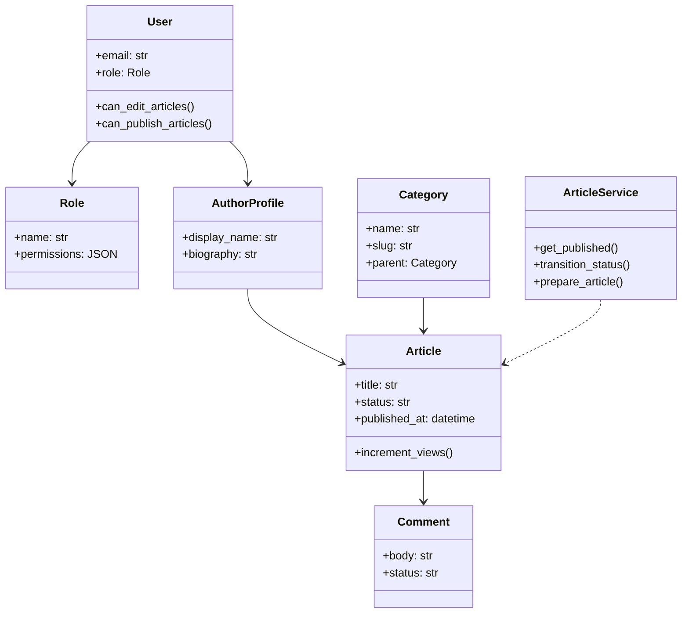
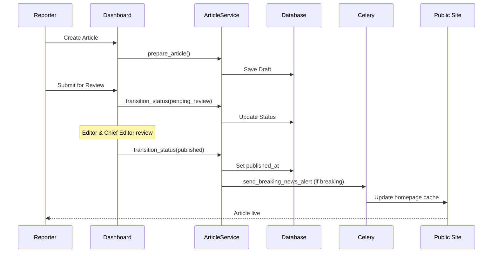

# NextGen News Management System

A production-ready Django news portal with editorial workflow, CMS, analytics, REST API, and AI-ready architecture.

## Features

- **Public Website** — Homepage, categories, article pages, search, newsletter
- **Editorial Workflow** — Draft → Review → Fact Check → Approval → Publish
- **CMS Dashboard** — Article management, comment moderation, analytics charts
- **REST API** — JWT authentication, full CRUD for articles, categories, authors
- **Real-time** — WebSocket notifications via Django Channels
- **Background Tasks** — Celery for analytics aggregation and scheduled publishing
- **SEO** — Sitemaps, Open Graph, Twitter Cards, Schema.org NewsArticle
- **Security** — CSRF, XSS headers, rate limiting, audit logs, RBAC

## Tech Stack

| Component | Technology |
|-----------|-----------|
| Framework | Django 5.x / 6.x |
| Database | PostgreSQL (SQLite for dev) |
| Cache | Redis |
| Task Queue | Celery |
| WebSockets | Django Channels |
| API | Django REST Framework + JWT |
| Frontend | Bootstrap 5, Chart.js, CKEditor 5 |
| Deployment | Docker, Gunicorn, Nginx |

## Quick Start

### Local Development

```bash
# Clone and setup
cd News
python -m venv venv
venv\Scripts\activate        # Windows
pip install -r requirements.txt
copy .env.example .env

# Database
python manage.py migrate
python manage.py seed_data
python manage.py runserver
```

Visit http://localhost:8000

**Default credentials (after seed):**
- Admin: `admin@nextgennews.com` / `Admin@12345`
- Reporter: `reporter@nextgennews.com` / `Reporter@12345`
- Staff portal (not linked on the public site): `/accounts/admin/login/`

### Docker Production

```bash
cp .env.example .env
docker-compose up -d --build
docker-compose exec web python manage.py migrate
docker-compose exec web python manage.py seed_data
docker-compose exec web python manage.py createsuperuser
```

## Project Structure

```
News/
├── accounts/          # Authentication, roles, user profiles
├── news/              # Articles, bookmarks, newsletter
├── categories/        # Categories and tags
├── authors/           # Author profiles
├── media_library/     # Media management
├── comments/          # Comments and moderation
├── advertisements/    # Ad management
├── analytics/         # Visitor tracking and charts
├── notifications/     # Email, push, in-app notifications
├── dashboard/         # Admin dashboard, settings, audit logs
├── search/            # Instant search and autocomplete
├── api/               # REST API endpoints
├── config/            # Settings, middleware, Celery, ASGI
├── templates/         # HTML templates
├── static/            # CSS, JavaScript
├── media/             # Uploaded files
├── nginx/             # Nginx configuration
└── tests/             # Integration tests
```

## User Roles

| Role | Permissions |
|------|------------|
| Super Admin | Full system access |
| Admin | User management, settings, publish |
| Chief Editor | Approve and publish articles |
| Editor | Review and edit articles |
| Reporter | Create and submit articles |
| Photographer | Upload media |
| Contributor | Submit articles |
| Moderator | Comment moderation |
| Registered Reader | Comment, bookmark |
| Guest | Read public content |

## API Endpoints

| Endpoint | Description |
|----------|------------|
| `POST /api/auth/token/` | Obtain JWT token |
| `GET /api/articles/` | List articles |
| `GET /api/articles/{id}/` | Article detail |
| `GET /api/categories/` | List categories |
| `GET /api/authors/` | List authors |
| `GET /api/search/?q=` | Search articles |
| `GET /api/analytics/` | Analytics data (admin) |

## Database Schema (ER Diagram)



## System Flow



## Use Case Diagram



## Class Diagram



## Sequence Diagram — Article Publish Flow



## Deployment Guide

### PythonAnywhere (recommended for shared hosting)

See **[PYTHONANYWHERE.md](PYTHONANYWHERE.md)** for a full checklist.

Quick start: set `DJANGO_ENV=pythonanywhere` in `.env`, install requirements in a virtualenv,
run `migrate` + `collectstatic`, point the WSGI file at `config.wsgi`, and map `/static/`
and `/media/` in the Web tab. Schedule `python manage.py scrape_news` under Tasks.

### Prerequisites (VPS / Docker)
- Python 3.12+
- PostgreSQL 16+
- Redis 7+
- Nginx (production)

### Production Checklist (VPS)

1. Set `DJANGO_ENV=production` in `.env`
2. Generate a strong `SECRET_KEY`
3. Configure PostgreSQL credentials
4. Set `ALLOWED_HOSTS` and `CSRF_TRUSTED_ORIGINS` to your domain
5. Enable `SECURE_SSL_REDIRECT=True`
6. Configure email SMTP settings
7. Run `python manage.py collectstatic`
8. Start Gunicorn + Nginx + Celery workers

### Gunicorn (manual)

```bash
gunicorn config.wsgi:application --bind 0.0.0.0:8000 --workers 3
```

### Celery

```bash
celery -A config worker -l info
celery -A config beat -l info
```

On PythonAnywhere, skip Celery and use Scheduled Tasks instead (see PYTHONANYWHERE.md).
## Running Tests

```bash
python manage.py test
pytest
```

## License

MIT License — NextGen News Management System
